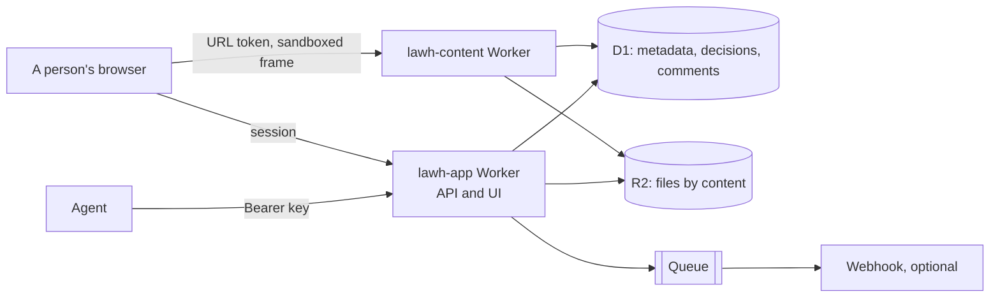

# Lawh v1 spec

| | |
|---|---|
| **Status** | Draft, waiting for review and the owner decisions in section 13 |
| **Last updated** | 2026-11-24 |
| **Files** | [Data model](schema.sql) · [API (OpenAPI 3.1)](openapi.yaml) · [Security model](security.md) · [People and teams](teams.md) · [Self-hosting](self-hosting.md) · [Mockups](mockups/index.html) · Checks: [query plans](checks/query_plans.py), [integrity](checks/integrity.py) |

## 1. Goal

Lawh (لوح, a writing tablet) is a private, self-hosted place where agents publish HTML pages (design documents, research, review galleries, dashboards) and people read them and record decisions: one owner, or an owner and teams.

- **Any agent.** Claude, Codex, Gemini, Kimi, GLM or a script: anything that can send HTTPS requests.
- **Any project.** One instance serves all of its projects. Lawh has no branding, login or data from any one of them.
- **Any device with a browser.** A normal HTTPS site, installable as a PWA.
- **Cloned and self-hosted.** People clone this repository and run their own copy in their own Cloudflare account. Each copy has one owner, who can invite people into teams. It needs no other product, and no copy knows about another. The code is public (MIT); a copy's hosts, keys and pages are private and never in this repository. See [self-hosting.md](self-hosting.md).

**Teams.** A person sees the projects their teams have, at a level: viewer, commenter, decider or manager. Off by default. See [teams.md](teams.md).

**Not in v1:** public sign-up, single sign-on, public share links, editing pages in the browser, real-time co-viewing, server-side code in pages, importing from other artifact systems.

## 2. What exists today

This repository has a README and a license. Nothing is built. There is no earlier code to reuse or migrate.

## 3. How it works

**Publishing** takes three steps, and only the last one changes what people see:

1. `POST …/versions` with the file list (path, SHA-256, size), page details and decisions. The reply lists the blobs still to send.
2. `PUT` each missing blob. R2 checks the hash.
3. `POST …/commit`. One D1 transaction creates the version.

A page's URL is `https://APP/p/<project>/<slug>` and never changes. `?v=3` opens an old version. Publishing on top of someone else's newer version gets 409. Files that didn't change are stored once.

**Decisions.** A page declares questions with a `key`, a question, context, and options (id, label, detail, cost note). The first option is the recommended one. No option is selected in advance, so a stray tap records nothing.

| Event | Result |
|---|---|
| New key | `open` |
| The owner or a decider answers (an option, notes, or both) | `answered`, a new row in the history with the person's name |
| Anyone who may answer answers again | New history row; the earlier one stays |
| Republished with the same wording | No change |
| Wording or options changed, not answered | New revision, still `open` |
| Wording or options changed, answered | New revision, `stale`: the old answer keeps its wording and the question is asked again |
| Key missing from a new list | `withdrawn`; history kept |
| A withdrawn key comes back | `open`, or `answered` if the wording matches the answered revision |

An answer sends the revision and the last answer number the person saw; if either changed on another device or by another person, it gets 409 and the form reloads. Answering a page's last `open` or `stale` decision moves the page from `in_review` to `decided`.

**Comments** belong to the page or to a section (heading id, title and a short quote, so a comment survives a republish; if the section is gone, the comment shows under "Earlier sections"). Commenters and above start threads; deciders resolve any, and people resolve their own. Agents reply.

**How agents learn of changes:** poll `GET /v1/decisions` or `GET /v1/events?after=`, or use a webhook. Polling works for an agent behind a home router.

## 4. Data model

[schema.sql](schema.sql) is the full model. Main points:

- **R2 holds files, D1 holds everything else.** Key `blobs/<sha256>/<ulid>`.
- **Answers are append only**, enforced by triggers, which also refuse an answer for an old revision or number, or from someone who may not answer.
- **A key with several projects** (20 at most) or a member (50 at most) runs one indexed query per project and merges the results.
- **Access comes only through teams.** `project_access` is a view over `team_members` and `team_projects`, always read for one member.
- **Every query is indexed.** [query_plans.py](checks/query_plans.py) builds the schema and fails on a table scan or a sort without an index. [integrity.py](checks/integrity.py) tests the races: answer against republish, purge, pruning, cleanup, first publish and search filters, plus sign-in, levels and removal. Both become CI checks in S1.
- **Lists use keyset pages** (30 by default, 100 at most), never `OFFSET` or `COUNT(*)`.
- **Search** is FTS5 over title, summary, tags and the page's visible text (first 200 KB). Arabic is normalized the same way on write and on search: no diacritics, one form of alef, ya and ta marbuta, and Western digits inside the index. Project, status and tag filters apply inside the index, before the limit of 100 matches, newest first. A soft-deleted page leaves the index. Each change gives the page a new, higher search rowid.
- **Publishing doesn't hit D1's 100-parameter limit:** file rows go in as one JSON parameter through `json_each`.

## 5. API

[openapi.yaml](openapi.yaml) covers the agent API: publish, update, list, search, read a page or file, decisions by page, id or status, comments, replies and events. Every write takes an `Idempotency-Key`.

The UI uses a separate `/app-api`, which accepts only a person's session: answer, comment, resolve, page status, delete and restore, projects, people, teams, keys, webhooks, sessions and switches, each at the level in [teams.md](teams.md). An agent key on `/app-api` gets 401, and a session on `/v1` gets 401.

## 6. Security

See [security.md](security.md): two hosts, an opaque-origin sandbox, the CSP, content tokens, the bridge, keys, uploads, webhooks, threats and tests.

## 7. UI

English and Arabic with full RTL, Arabic digits ٠–٩ through one formatter. Arabic text doesn't assume a person's gender: levels are nouns (مشاهدة، تعليق، اتخاذ القرار، إدارة). Dark by default; the Light/Dark switch is remembered per device. Touch targets are at least 44 px, and text contrast meets WCAG AA. Dialogs are in-app, never `alert` or `confirm`. Search is a live autocomplete.

| Screen | Mockups |
|---|---|
| Pages | [desktop](mockups/png/library-en-dark-1280.png) · [phone](mockups/png/library-en-dark-390.png) · [phone, Arabic, light](mockups/png/library-ar-light-390.png) |
| Page with decisions | [desktop](mockups/png/page-en-dark-1280.png) · [desktop, Arabic](mockups/png/page-ar-dark-1280.png) · [phone, light](mockups/png/page-en-light-390.png) |
| Full-size viewer | [phone](mockups/png/viewer-en-dark-390.png) |
| Open decisions | [desktop](mockups/png/inbox-en-dark-1280.png) · [phone, Arabic](mockups/png/inbox-ar-dark-390.png) |
| Comments | [phone](mockups/png/comments-en-dark-390.png) |
| Agent keys | [desktop, Arabic, light](mockups/png/keys-ar-light-1280.png) |
| Sign-in | [phone](mockups/png/signin-en-dark-390.png) |
| Team | [desktop](mockups/png/team-en-dark-1280.png) · [phone, Arabic, light](mockups/png/team-ar-light-390.png) |
| Invite | [phone](mockups/png/invite-en-dark-390.png) · [desktop, Arabic](mockups/png/invite-ar-dark-1280.png) |
| Join from an invite | [phone](mockups/png/join-en-light-390.png) · [phone, Arabic](mockups/png/join-ar-dark-390.png) |

Examples in the mockups are made up. On a phone the page fills the screen and decisions open as a sheet from the fixed button.

**Viewer.** Every `img`, `svg`, `canvas` and `picture` in a page opens full size: Esc closes, arrows move between a page's images (mirrored in Arabic), `+`, `−`, wheel and pinch zoom, drag moves, double tap fits. Focus returns to where it was.

**What pages must know.** No outside network, no `localStorage`, no popups or form posts. Scripts, styles, fonts, images and JSON data go in the upload. The page receives the theme and language as `data-lawh-mode` and `data-lawh-lang` on `<html>`.

## 8. Platforms

| Where | What it needs |
|---|---|
| Desktop and laptop browsers | Current Chrome, Edge, Firefox, Safari |
| iPhone, iPad, Android | The same site. PWA: manifest (en, ar), icons, standalone display. The service worker caches only the app's own files, never pages, answers or API replies |
| T3 Code's browser panel | Works as a website. A panel may not offer passkeys; S4 includes approving a sign-in from a device that is already signed in |
| Agents | HTTPS. A small `lawh publish <folder>` command (S11) and MCP tools (S12) |

There are no native apps.

## 9. Switches

- `instance`: **off by default.** While off, every route on both hosts answers 404 `feature_off`, except sign-in and the switch itself for a signed-in owner.
- `teams`: off by default. While off, only the owner's session and agents work, every other member gets 404 `feature_off`, and the Teams screens aren't shown.
- `webhooks`, `mcp`: off by default. While off, their routes answer 404 and their UI isn't shown.

Switches are in `settings` and enforced by the server. There are no tiers.

## 10. Tests

- **Unit and API:** Workers test pool with local D1 and R2. Scope and project checks for every route × key type, and every `/app-api` route × level; 409 paths; decision table above, row by row; append-only triggers; a publish that fails halfway changes nothing; upload limits; the query-plan check.
- **Security:** the hostile fixtures in security.md section 10, on three browser engines.
- **UI:** Playwright on the local stack, en and ar, light and dark, 390 and 1280 px; keyboard only; axe.
- Each test creates its own data and deletes it even when it fails. Nothing runs against a deployed instance. No retries.

## 11. Cost

Gross list prices per month, before the free allowances, read 2026-11-24 ([Workers](https://developers.cloudflare.com/workers/platform/pricing/), [D1](https://developers.cloudflare.com/d1/platform/pricing/), [R2](https://developers.cloudflare.com/r2/pricing/), [Queues](https://developers.cloudflare.com/queues/platform/pricing/)). These are estimates from the assumptions below, not measurements.

| | Small | Medium | Large |
|---|---|---|---|
| Pages / stored files | 200 / 4 GB | 2,000 / 40 GB | 20,000 / 400 GB |
| Page views a month | 1,000 | 10,000 | 100,000 |
| Versions published a month | 200 | 2,000 | 20,000 |
| Workers requests and CPU | $0.01 | $0.15 | $1.50 |
| R2 storage | $0.06 | $0.60 | $6.00 |
| R2 operations | $0.02 | $0.21 | $2.07 |
| D1 reads, writes, storage | $0.12 | $1.18 | $11.76 |
| Queue | $0.00 | $0.00 | $0.04 |
| **Total** | **$0.21** | **$2.14** | **$21.37** |

- **Unit costs:** about $0.00002 a page view and $0.00048 a published version, plus $0.015 per GB stored a month.
- **Assumptions:** 26 requests a view, 20 of them files; 20 requests and 15 new blobs a version; 10 ms CPU a request; 400 rows written a version (D1 bills each index and search-index row; S9 measures it); 120 rows read a view. D1 holds 0.05, 0.5 and 5 GB.
- **Workers Paid is required** ($5 a month for the account if it isn't on it already). The free plan caps a request at 10 ms of CPU, which search indexing and uploads exceed, and keeps D1 Time Travel for less time.
- People cost nothing by themselves. With teams, a request reads a few more rows to find the person's level, inside the assumption above.
- `workers.dev` hosts and custom domains include their certificates, so no certificate add-on is needed.
- The bill grows with stored versions; each copy's retention setting decides how long they are kept.

## 12. Legal and safety

- Pages can hold personal or confidential data. The instance is private, every response is `noindex`, and logs hold no page text, answers, comments, tokens or keys.
- Deletes are soft, with a 30-day purge that removes files, text, answers and comments. Deleting a thread's first comment deletes its replies. Purge order for a page: search rows, tags, comments, answers, revisions, decisions, version files, versions, page. D1 Time Travel keeps deleted rows for up to 30 more days on the paid plan.
- Uploads are refused when they contain key-shaped strings.
- Lawh stores a display name and passkeys for each person, no email address. Agents whose keys can read a project see the names of people who answered or commented there. A removed person's name is cleared after 30 days.
- Export: the owner can download everything as a ZIP (S10).
- A page must not copy third-party material its author has no right to keep.

## 13. Owner decisions

Asked one at a time. Answers are recorded here. These are choices for the product, so they apply to every copy. Hosts, Cloudflare account, name and version retention aren't here: each copy sets its own ([self-hosting.md](self-hosting.md)).

| # | Question | Options (recommended first) | Why | Blocks | Answer |
|---|---|---|---|---|---|
| 1 | Which login ships? | **a. Built-in passkeys.** b. Cloudflare Access | (a) works right after a clone, with nothing else to set up, and in an installed PWA. (b) is less code here, but every self-hoster sets up Access first, and its redirect breaks background requests when a session ends. Signing in through one product's identity service is ruled out: other people's copies can't use it | S4 | **a, and spec teams** (2026-11-24): [teams.md](teams.md) |
| 2 | Where do agent keys live? | **a. Hashes in D1, pepper in the Secrets Store, the agent's own copy in its machine's keychain.** b. One Secrets Store secret per agent, bound to the Worker. c. Both: (a) for local agents, (b) for agents that are Workers | Secrets Store values can't be read back, so a laptop agent needs a local copy either way. (b) needs a redeploy for each key, and the store holds 100 secrets an account in open beta | S2 | – |
| 3 | May pages load libraries from CDNs? | **a. No, upload everything.** b. A fixed list of CDN hosts | A CDN host is a way out for data, and pages stay readable for years only if they are complete | S3 | – |
| 4 | MCP tools in v1? | **a. Yes, after the API.** b. Later | MCP lets every provider publish without custom code; it is a thin layer over `/v1` | S12 | – |
| 5 | In a team, is one answer enough? | **a. Yes, the first decider's answer decides.** b. A project can ask for two or more deciders to agree | (a) is the same flow as alone, and an answer can be changed with its history kept. (b) adds a waiting state, disagreements and a stale rule per vote | S7 | – |

## 14. Stories, one PR each

| # | Story | Needs |
|---|---|---|
| S1 | Workspace, CI, migrations from schema.sql, query-plan check, `instance` switch off, both Workers answering 404 | – |
| S2 | Agent keys, projects, publish API (start, blob, commit), list, read, versions | D2 |
| S3 | Content Worker: tokens, sandbox, headers, bridge, hostile-page tests | S2, D3 |
| S4 | Passkey sign-in, sessions, device approval, owner setup, recovery and transfer | S1 |
| S5 | Pages list with project, status and tag filters, page view, versions, theme, en and ar; `levelOn` on every route | S3, S4 |
| S6 | Full-size viewer | S5 |
| S7 | Decisions: API, page panel, open-decisions screen | S5, D5 |
| S8 | Comments: API, section anchors, threads | S5 |
| S9 | Search: FTS index, Arabic normalization, autocomplete | S5 |
| S10 | Settings: keys, projects, delete, restore, purge, export, version retention | S4 |
| S11 | `lawh publish` command and a publishing guide for agents | S2 |
| S12 | MCP tools, behind `mcp` | S7, S8, D4 |
| S13 | Events feed, webhooks and queue, behind `webhooks` | S7 |
| S14 | PWA: manifest, icons, service worker | S5 |
| S15 | `lawh init`, `upgrade`, `rollback`, `destroy`, fork-safe CI, the check that no instance details are committed | S4, S10 |
| S16 | First real use: five design documents with charts and decisions, published to the author's private copy (not in this repository) | S7, S11, S15 |
| S17 | People: invite, join, reset, remove, behind `teams` | S10 |
| S18 | Teams: levels, projects, managers' agents and keys, every route × level test, behind `teams` | S7, S8, S9, S17 |

S1 needs no decision. D2 to D5 are the decisions in section 13; D1 is answered. The tables for people and teams are in S1, so S17 and S18 change no existing table, and S16 doesn't wait for them.
