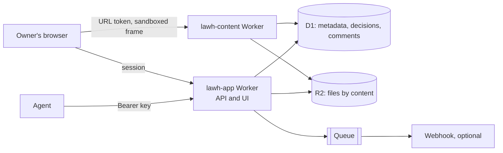

# Lawh v1 spec

| | |
|---|---|
| **Status** | Draft, waiting for review and the owner decisions in section 13 |
| **Last updated** | 2026-11-24 |
| **Files** | [Data model](schema.sql) · [API (OpenAPI 3.1)](openapi.yaml) · [Security model](security.md) · [Mockups](mockups/index.html) · [Query-plan check](checks/query_plans.py) |

## 1. Goal

Lawh (لوح, a writing tablet) is a private, self-hosted place where agents publish HTML pages (design documents, research, review galleries, dashboards) and their owner reads them and records decisions.

- **Any agent.** Claude, Codex, Gemini, Kimi, GLM or a script: anything that can send HTTPS requests.
- **Any project.** One instance serves all of the owner's projects. Lawh has no branding, login or data from any one of them.
- **Any device with a browser.** A normal HTTPS site, installable as a PWA.
- **Standalone.** It runs in one Cloudflare account and needs no other product. The code is public (MIT); each instance's hosts, keys and pages are private and never in this repository.

**Not in v1:** several owners or teams, public share links, editing pages in the browser, real-time co-viewing, server-side code in pages, importing from other artifact systems.

## 2. What exists today

This repository has a README and a license. Nothing is built. There is no earlier code to reuse or migrate.

## 3. How it works

**Publishing** takes three steps, and only the last one changes what the owner sees:

1. `POST …/versions` with the file list (path, SHA-256, size), page details and decisions. The reply lists the blobs still to send.
2. `PUT` each missing blob. R2 checks the hash.
3. `POST …/commit`. One D1 transaction creates the version.

A page's URL is `https://APP/p/<project>/<slug>` and never changes. `?v=3` opens an old version. Publishing on top of someone else's newer version gets 409. Files that didn't change are stored once.

**Decisions.** A page declares questions with a `key`, a question, context, and options (id, label, detail, cost note). The first option is the recommended one. No option is selected in advance, so a stray tap records nothing.

| Event | Result |
|---|---|
| New key | `open` |
| The owner answers (an option, notes, or both) | `answered`, a new row in the history |
| The owner answers again | New history row; the earlier one stays |
| Republished with the same wording | No change |
| Wording or options changed, not answered | New revision, still `open` |
| Wording or options changed, answered | New revision, `stale`: the old answer keeps its wording and the owner is asked again |
| Key missing from a new list | `withdrawn`; history kept |
| A withdrawn key comes back | `open`, or `answered` if the wording matches the answered revision |

An answer sends the revision and the last answer number the owner saw; if either changed on another device, it gets 409 and the form reloads. Answering a page's last open decision moves the page from `in_review` to `decided`.

**Comments** belong to the page or to a section (heading id, title and a short quote, so a comment survives a republish; if the section is gone, the comment shows under "Earlier sections"). Only the owner starts and resolves threads. Agents reply.

**How agents learn of changes:** poll `GET /v1/decisions` or `GET /v1/events?after=`, or use a webhook. Polling works for an agent behind a home router.

## 4. Data model

[schema.sql](schema.sql) is the full model. Main points:

- **R2 holds files, D1 holds everything else.** Key `blobs/<sha256>/<ulid>`.
- **Answers are append only**, enforced by triggers.
- **Every query is indexed.** [query_plans.py](checks/query_plans.py) builds the schema and fails on a table scan or a sort without an index. It becomes a CI check in S1.
- **Lists use keyset pages** (30 by default, 100 at most), never `OFFSET` or `COUNT(*)`.
- **Search** is FTS5 over title, summary, tags and the page's visible text (first 200 KB). Arabic is normalized the same way on write and on search: no diacritics, one form of alef, ya and ta marbuta, and Western digits inside the index. One query reads at most 100 matches.
- **Publishing doesn't hit D1's 100-parameter limit:** file rows go in as one JSON parameter through `json_each`.

## 5. API

[openapi.yaml](openapi.yaml) covers the agent API: publish, update, list, search, read a page or file, decisions by page, id or status, comments, replies and events. Every write takes an `Idempotency-Key`.

The UI uses a separate `/app-api`, which accepts only the owner session: answer, comment, resolve, page status, delete and restore, projects, keys, webhooks, sessions and switches. An agent key on `/app-api` gets 401, and an owner session on `/v1` gets 401.

## 6. Security

See [security.md](security.md): two hosts, an opaque-origin sandbox, the CSP, content tokens, the bridge, keys, uploads, webhooks, threats and tests.

## 7. UI

English and Arabic with full RTL, Arabic digits ٠–٩ through one formatter. Dark by default; the Light/Dark switch is remembered per device. Touch targets are at least 44 px, and text contrast meets WCAG AA. Dialogs are in-app, never `alert` or `confirm`. Search is a live autocomplete.

| Screen | Mockups |
|---|---|
| Pages | [desktop](mockups/png/library-en-dark-1280.png) · [phone](mockups/png/library-en-dark-390.png) · [phone, Arabic, light](mockups/png/library-ar-light-390.png) |
| Page with decisions | [desktop](mockups/png/page-en-dark-1280.png) · [desktop, Arabic](mockups/png/page-ar-dark-1280.png) · [phone, light](mockups/png/page-en-light-390.png) |
| Full-size viewer | [phone](mockups/png/viewer-en-dark-390.png) |
| Open decisions | [desktop](mockups/png/inbox-en-dark-1280.png) · [phone, Arabic](mockups/png/inbox-ar-dark-390.png) |
| Comments | [phone](mockups/png/comments-en-dark-390.png) |
| Agent keys | [desktop, Arabic, light](mockups/png/keys-ar-light-1280.png) |
| Sign-in | [phone](mockups/png/signin-en-dark-390.png) |

Examples in the mockups are made up. On a phone the page fills the screen and decisions open as a sheet from the fixed button.

**Viewer.** Every `img`, `svg`, `canvas` and `picture` in a page opens full size: Esc closes, arrows move between a page's images (mirrored in Arabic), `+`, `−`, wheel and pinch zoom, drag moves, double tap fits. Focus returns to where it was.

**What pages must know.** No outside network, no `localStorage`, no popups or form posts. Scripts, styles, fonts, images and JSON data go in the upload. The page receives the theme and language as `data-lawh-mode` and `data-lawh-lang` on `<html>`.

## 8. Platforms

| Where | What it needs |
|---|---|
| Desktop and laptop browsers | Current Chrome, Edge, Firefox, Safari |
| iPhone, iPad, Android | The same site. PWA: manifest (en, ar), icons, standalone display. The service worker caches only the app's own files, never pages, answers or API replies |
| T3 Code's browser panel | Works as a website. A panel may not offer passkeys; S4 includes approving a sign-in from a device that is already signed in |
| Agents | HTTPS. A small `lawh publish <folder>` command (S11) and MCP tools (S12) |

There are no native apps.

## 9. Switches

- `instance`: **off by default.** While off, every route on both hosts answers 404 `feature_off`, except sign-in and the switch itself for a signed-in owner.
- `webhooks`, `mcp`: off by default. While off, their routes answer 404 and their UI isn't shown.

Switches are in `settings` and enforced by the server. There are no tiers.

## 10. Tests

- **Unit and API:** Workers test pool with local D1 and R2. Scope and project checks for every route × key type; 409 paths; decision table above, row by row; append-only triggers; a publish that fails halfway changes nothing; upload limits; the query-plan check.
- **Security:** the hostile fixtures in security.md section 10, on three browser engines.
- **UI:** Playwright on the local stack, en and ar, light and dark, 390 and 1280 px; keyboard only; axe.
- Each test creates its own data and deletes it even when it fails. Nothing runs against a deployed instance. No retries.

## 11. Cost

Gross list prices per month, before the free allowances, read 2026-11-24 ([Workers](https://developers.cloudflare.com/workers/platform/pricing/), [D1](https://developers.cloudflare.com/d1/platform/pricing/), [R2](https://developers.cloudflare.com/r2/pricing/), [Queues](https://developers.cloudflare.com/queues/platform/pricing/)). These are estimates from the assumptions below, not measurements.

| | Small | Medium | Large |
|---|---|---|---|
| Pages / stored files | 200 / 4 GB | 2,000 / 40 GB | 20,000 / 400 GB |
| Page views a month | 1,000 | 10,000 | 100,000 |
| Versions published a month | 200 | 2,000 | 20,000 |
| Workers requests and CPU | $0.02 | $0.15 | $1.50 |
| R2 storage | $0.06 | $0.60 | $6.00 |
| R2 operations | $0.02 | $0.21 | $2.07 |
| D1 reads, writes, storage | $0.05 | $0.50 | $4.96 |
| Queue | $0.00 | $0.00 | $0.01 |
| **Total** | **$0.15** | **$1.45** | **$14.54** |

- **Unit costs:** about $0.00002 a page view and $0.00014 a published version, plus $0.015 per GB stored a month.
- **Assumptions:** 26 requests a view, 20 of them files; 20 requests and 15 new blobs a version; 10 ms CPU a request; 60 rows written a version; 100 rows read a view. D1 holds 0.05, 0.5 and 5 GB.
- **The account's Workers Paid plan** ($5 a month) is extra if the account doesn't have it. Small fits inside the free allowances, when nothing else in the account uses them.
- Custom domains include their certificates, so no certificate add-on is needed.
- The bill grows with stored versions; decision 5 sets how long they are kept.

## 12. Legal and safety

- Pages can hold personal or confidential data. The instance is private, every response is `noindex`, and logs hold no page text, answers, comments, tokens or keys.
- Deletes are soft, with a 30-day purge that removes files, text, answers and comments. R2 and D1 backups age out on Cloudflare's schedule (D1 Time Travel: up to 30 days).
- Uploads are refused when they contain key-shaped strings.
- Export: the owner can download everything as a ZIP (S10).
- A page must not copy third-party material its author has no right to keep.

## 13. Owner decisions

Asked one at a time. Answers are recorded here.

| # | Question | Options (recommended first) | Why | Blocks |
|---|---|---|---|---|
| 1 | Which login? | **a. Built-in passkeys, owner only.** b. Cloudflare Access. c. An existing identity service, through OpenID Connect, super admin with passkey required | (a) is standalone, works in an installed PWA and adds no service. (b) needs little code, but its redirect breaks background requests in a PWA when the session ends, and it adds an outside dependency. (c) ties a generic tool to one product's uptime and roles | S4 |
| 2 | Which hosts and which Cloudflare account? | **a. Two subdomains of a domain the owner keeps for tools.** b. Two subdomains of a product's domain. c. A new domain | Two exact hosts are needed, app and content. A tools domain keeps untrusted pages away from any product's cookies | S2 deploy |
| 3 | Where do agent keys live? | **a. Hashes in D1, pepper in the Secrets Store, the agent's own copy in its machine's keychain.** b. One Secrets Store secret per agent, bound to the Worker. c. Both: (a) for local agents, (b) for agents that are Workers | Secrets Store values can't be read back, so a laptop agent needs a local copy either way. (b) needs a config change for each key, and the store holds 100 secrets an account in open beta | S2 |
| 4 | May pages load libraries from CDNs? | **a. No, upload everything.** b. A fixed list of CDN hosts | A CDN host is a way out for data, and pages stay readable for years only if they are complete | S3 |
| 5 | How long are old versions kept? | **a. Forever.** b. Last 20, plus any version with an answer or comment. c. One year | About $0.015 per GB a month. Decisions always keep their own wording | S10 |
| 6 | MCP tools in v1? | **a. Yes, after the API.** b. Later | MCP lets every provider publish without custom code; it is a thin layer over `/v1` | S12 |

## 14. Stories, one PR each

| # | Story | Needs |
|---|---|---|
| S1 | Workspace, CI, migrations from schema.sql, query-plan check, `instance` switch off, both Workers answering 404 | – |
| S2 | Agent keys, projects, publish API (start, blob, commit), list, read, versions | D2, D3 |
| S3 | Content Worker: tokens, sandbox, headers, bridge, hostile-page tests | S2, D4 |
| S4 | Owner login, sessions, device approval | D1 |
| S5 | Pages list with project, status and tag filters, page view, versions, theme, en and ar | S3, S4 |
| S6 | Full-size viewer | S5 |
| S7 | Decisions: API, page panel, open-decisions screen | S5 |
| S8 | Comments: API, section anchors, threads | S5 |
| S9 | Search: FTS index, Arabic normalization, autocomplete | S5 |
| S10 | Settings: keys, projects, delete, restore, purge, export, version retention | S4, D5 |
| S11 | `lawh publish` command and a publishing guide for agents | S2 |
| S12 | MCP tools, behind `mcp` | S7, S8, D6 |
| S13 | Events feed, webhooks and queue, behind `webhooks` | S7 |
| S14 | PWA: manifest, icons, service worker | S5 |
| S15 | First real use: five design documents with charts and decisions, published to the private instance (not in this repository) | S7, S11 |

S1 needs no decision. D1 to D6 are the decisions in section 13.
